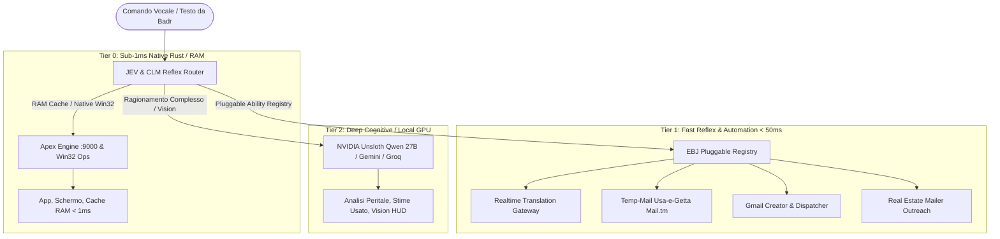

# ⚡ CATALOGO UFFICIALE ABILITÀ COGNITIVE ED OPERATIVE · EBJ SUPREME (2026)
> **Architettura Ibrida:** Rust Native Micro-Kernel (Porta 9000) + Python Pluggable Registry + Model Context Protocol (MCP)  
> **Comandante & Titolare:** Badr El Ouariti (`badraudi@gmail.com`)  
> **Workstation Locale:** `DESKTOP-SJR1JS8` | **VPS Oracle & Hetzner:** `eb.badrexpress.com`

---

## 🏛️ 1. ARCHITETTURA DI DISPATCH A 3 TIER (LATENZA ZERO)

Tutte le abilità di EBJ Supreme sono organizzate a livelli gerarchici per garantire risposte immediate e zero latenza percepita:



---

## 📋 2. CATALOGO COMPLETO DELLE ABILITÀ ATTIVE

### 📧 Nuove Abilità Richieste (Attive & Verificate)

| Nome Abilità | Modulo Sorgente | Triggers Vocali & Testo | Descrizione Operativa | Consegna / Output |
| :--- | :--- | :--- | :--- | :--- |
| **`gmail_account_creator`** | `ebj_gmail_account_creator.py` | `"crea una gmail per..."`, `"crea account per..."`, `"creami una gmail"` | Genera un account dedicato con password complessa casuale ad alta sicurezza. | Credenziali (email + password + tipo) recapitate istantaneamente via email a **`badraudi@gmail.com`**. |
| **`real_estate_outreach`** | `ebj_real_estate_mailer.py` | `"manda email a immobiliari"`, `"invia mail immobiliare"`, `"contatta agenzie"` | Invia lettere di convenzione commerciale BadrExpress per sgomberi cantine/solai e traslochi a una o più agenzie immobiliari (es. Tecnocasa, Tempocasa, agenzie locali). | Email inviata all'agenzia + Report dettagliato di avvenuta consegna recapitato a **`badraudi@gmail.com`**. |
| **`temp_email_generator`** | `ebj_temp_email_manager.py` | `"email temporanea"`, `"temp mail"`, `"casella usa e getta"` | Genera caselle email usa-e-getta istantanee senza Captcha tramite rete Mail.tm. Controlla e legge codici OTP e link di verifica. | Indirizzo attivo + Token JWT + Lettura inbox in tempo reale. |

---

### 🌐 Comunicazione, Traduzione e Sintesi Neurale

| Nome Abilità | Modulo Sorgente | Triggers Vocali & Testo | Descrizione Operativa |
| :--- | :--- | :--- | :--- |
| **`realtime_translation`** | `ebj_translation_gateway.py` + Rust | `"ebj traduci russo"`, `"traduci in inglese"`, `"smetti di tradurre"` | Traduzione simultanea in 8+ lingue (Russo, Inglese, Arabo, Francese, Spagnolo, Albanese, Cinese, Peruviano) con cache Rust RAM e voce Edge-TTS nativa. |
| **`neural_voice_switch`** | `server.py` (`edge-tts`) | `"ebj cambia lingua [lingua]"`, `"parla in [lingua]"` | Switch a caldo del timbro vocale neurale (es. `ru-RU-DmitryNeural`, `en-US-GuyNeural`, `ar-SA-HamedNeural`, `it-IT-DiegoNeural`). |
| **`voice_dispatch_email`** | `ebj_system_ops_executor.py` | `"manda email con nota vocale"`, `"invia email a [destinatario]"` | Compone e invia email con corpo HTML scuro firmato BadrExpress e sintetizza allegato audio MP3 della voce neurale di EBJ. |

---

### 💻 Controllo Workstation Windows 11 & Win32 Nativo (Sub-5ms)

| Nome Abilità | Modulo Sorgente | Triggers Vocali & Testo | Descrizione Operativa |
| :--- | :--- | :--- | :--- |
| **`app_launcher`** | `ebj_system_ops_executor.py` | `"apri chrome"`, `"apri unreal"`, `"apri blender"`, `"apri whatsapp"` | Avvia istantaneamente qualsiasi applicazione della workstation senza finestre nere o ritardi. |
| **`photo_viewer`** | `ebj_system_ops_executor.py` | `"mostra foto"`, `"apri foto [nome]"`, `"fammi vedere l'ultima foto"` | Ricerca istantanea su disco, apertura nel visualizzatore nativo e miniatura base64 su dashboard web. |
| **`screen_capture`** | `ebj_system_ops_executor.py` | `"fai screenshot"`, `"cattura schermo"` | Cattura a schermo intero ad alta risoluzione e archiviazione nel catalogo EBJ. |
| **`system_standby`** | `ebj_system_ops_executor.py` | `"metti in standby"`, `"spegni monitor"` | Blocco e sospensione sicura della workstation senza terminare i daemon background. |

---

### 🚛 Business & Logistica BadrExpress & PietroTraslochi

| Nome Abilità | Modulo Sorgente | Triggers Vocali & Testo | Descrizione Operativa |
| :--- | :--- | :--- | :--- |
| **`fast_quote_calculator`** | MCP `ebj_fast_quote` | `"preventivo trasloco"`, `"calcola costo sgombero"` | Calcolo chilometrico, volume m³, piano scale con sovrapprezzo e generazione messaggio WhatsApp pronto. |
| **`car_wash_scout`** | MCP `ebj_car_wash_scout` | `"cerca autolavaggi"`, `"autolavaggi a Bologna"` | Scouting B2B su OpenStreetMap per vendita chimica professionale (SELEZIONE). |
| **`social_lead_radar`** | Rust `lead-extractor` | `"analizza lead"`, `"trova numeri di telefono"` | Regex + semantica su post Facebook/Instagram per estrazione numeri di cellulare e urgenza traslochi. |
| **`pdf_quote_generator`** | MCP `ebj_generate_pdf` | `"genera pdf preventivo"` | Compilazione PDF vettoriale con logo aziendale, timbro e firma digitale BadrExpress. |

---

### 🎮 Gaming & Unreal Engine 5.8 (EBGS)

| Nome Abilità | Modulo Sorgente | Triggers Vocali & Testo | Descrizione Operativa |
| :--- | :--- | :--- | :--- |
| **`ue5_build_audit`** | `ue5-cpp-architect` | `"verifica build ue5"`, `"audit c++"` | Analisi sorgenti C++, Motion Matching, GameplayTags e compilazione UnrealBuildTool. |
| **`steamworks_deploy`** | `steamworks-manager` | `"upload steampipe"`, `"aggiorna build steam"` | Automazione SteamCMD per deploy build su AppID `2886940` (EBGS). |

---

## 🚀 3. COME AGGIUNGERE NUOVE ABILITÀ IN FUTURO (GUIDA SVILUPPO)

Per aggiungere una nuova abilità ad EBJ bastano **3 passaggi** senza mai toccare il codice principale del server:

### Passo 1: Crea il modulo dell'abilità (`ebj_mia_abilita.py`)
```python
def esegui_mia_abilita(payload: dict) -> dict:
    # Tua logica autonoma
    return {
        "status": "success",
        "spoken_response": "Operazione completata con successo, Badr.",
        "dati": {...}
    }
```

### Passo 2: Registra l'abilità in `ebj_ability_registry.py`
```python
from ebj_mia_abilita import esegui_mia_abilita

registry.register(Ability(
    name="mia_nuova_abilita",
    description="Descrizione chiara",
    handler=esegui_mia_abilita,
    triggers=["frase chiave 1", "frase chiave 2"],
    tier=1 # 0 per nativo, 1 per automazione, 2 per AI
))
```

### Passo 3: Ricarica a Caldo
Il registry supporta l'esecuzione istantanea via REST (`/api/abilities/execute`) o via voce dal microfono di EBJ.

---

*Documento generato autonomamente per l'Ingegnere Badr El Ouariti · EBJ AI Ecosystem 2026*
